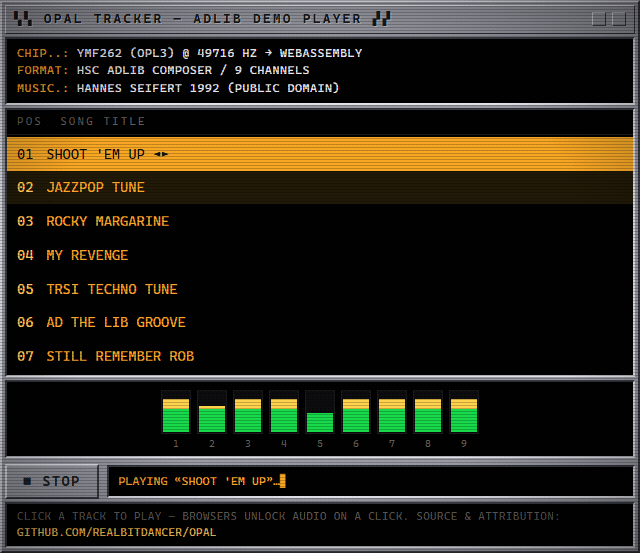

# opal

[](https://github.com/RealBitdancer/opal/actions/workflows/windows.yml)
[](https://github.com/RealBitdancer/opal/actions/workflows/linux.yml)
[](https://github.com/RealBitdancer/opal/actions/workflows/macos.yml)
[](https://github.com/RealBitdancer/opal/actions/workflows/android.yml)
[](https://github.com/RealBitdancer/opal/actions/workflows/ios.yml)
[](https://realbitdancer.github.io/opal/?play=1)

A feature-complete OPL2 and OPL3 FM synthesis core in C11 with a small API and a
permissive license.

**Want to hear it?** Try the [live web demo](https://realbitdancer.github.io/opal/?play=1). It runs in
your browser as WebAssembly, no build needed.

[](https://realbitdancer.github.io/opal/?play=1)

*Click the preview or the link above to open the player.*

## About

opal emulates the Yamaha YMF262, better known as the OPL3, together with its OPL2
predecessor. These are the chips that powered the AdLib and Sound Blaster cards, and
through them most of the music in DOS games and trackers. The core was written by Shayde
of Reality for Reality Adlib Tracker 2 and released into the public domain. What you find
here is a C11 port derived from the OpenMPT copy and wrapped in a small C API.

Feature-complete means the full register set that affects audio. The core implements two-
and four-operator FM, all eight waveforms, the tremolo and vibrato LFOs, percussion mode
with its noise generator, and the timers with their status register. Register 08 bit 7
(CSW on the YM3812) is unused on the YMF262, and opal leaves it unused. The OPL2 waveform
select enable bit is stored and ignored, because the YMF262 ignores that one too. NEW
(register 105h bit 0) is live: while it is clear the chip is in OPL2 compatibility mode,
so the second register array is ignored (except 105h itself), channels 9-17 stay silent,
waveforms 4-7 fold to 0-3, CHA/CHB force both speakers, and four-operator pairing is
decoded as two-operator.

## Accuracy

The operator, envelope, LFO, rhythm, feedback, and slot pipeline match
[Nuked-OPL3](https://github.com/nukeykt/Nuked-OPL3) at the chip's native 49716 Hz.
Compatibility mode (NEW clear) follows the real YMF262: bank 1 is inert except register
105h, channels 9-17 stay silent, waveforms 4-7 fold to 0-3, and CHA/CHB force both
speakers. The right channel arrives one sample after the left because the YMF262
pipeline delays it. Reproducing the quirk is cheaper than explaining its absence.

## Building

You need CMake 3.23 or newer and a C11 compiler. Presets exist for Windows (MSVC, Clang,
and MinGW in 32- and 64-bit), Linux (GCC), and macOS (Clang). All presets except the
Visual Studio ones use Ninja Multi-Config and expect ninja on PATH. The full list lives
in CMakePresets.json.

    cmake --preset default
    cmake --build --preset debug

On Linux or macOS use the matching presets:

    cmake --preset linux            # or: macos
    cmake --build --preset linux-debug

The result is a static library. Link opal and include include/opal/opal.h. The example
player builds by default. Set -DOPAL_BUILD_EXAMPLES=OFF if you do not want it.

Three cross presets cover platforms that cannot run the console player. The `android`
preset needs the NDK and `ANDROID_NDK_HOME`, and `ios` needs a macOS host. Both build the
library alone. The `web` preset needs an active Emscripten SDK and builds the browser
player described below.

To install and consume opal from another CMake project:

    cmake --install build/msvc-x64 --prefix /path/to/prefix
    # In your CMakeLists.txt:
    # find_package(opal 2.0 REQUIRED)
    # target_link_libraries(myapp PRIVATE opal::opal)

## Usage

The public interface is eight functions, declared in `include/opal/opal.h`. The same
header defines `OPAL_VERSION_MAJOR`, `OPAL_VERSION_MINOR`, `OPAL_VERSION_PATCH`, and
the packed `OPAL_VERSION` (`major * 10000 + minor * 100 + patch`). Drive the chip the
way you would drive the real one. Write registers, then read back stereo samples at
whatever rate you asked for.

```c
#include <opal/opal.h>

Opal chip;
opalInit(&chip, 48000);
opalWriteReg(&chip, 0x20, 0x21);
/* set registers, key on, etc */

int16_t left, right;
opalSample(&chip, &left, &right);
```

The instance holds no internal pointers: every cross reference is an index. Copy it,
assign it, memcpy it, or move it freely. A copy is a complete save state and plays on
from the moment it was taken.

Internally the chip always runs at its native 49716 Hz and resamples to the rate passed
to `opalInit` or `opalSetSampleRate`. `opalWriteReg` writes a register on the current
sample. `opalWriteRegBuffered` queues writes spaced a few chip samples apart for more
accurate timing. `opalFlushWriteBuf` applies any queue at once. `opalPan` adds
per-channel panning on top of the chip's own left and right enables (channel index 0 to
17, or 0 to 8 with bit 8 set for the second bank). `opalReadStatus` returns the status
register, which timer polling code will want.

## Example player

The bundled `player` streams OPL music to the default audio device through miniaudio. It
reads DRO version 1, HSC, and IMF or WLF files.

```sh
player song.dro
player song.hsc
player song.imf
player --rate 700 song.wlf
```

A few limitations are worth knowing. DRO files must be version 1, meaning the low 16 bits
of the version word at offset 8 are zero. Both the usual 24-byte v1 header and the early
DOSBox 21-byte form (single-byte hardware type, no padding) are accepted. HSC has no
signature, so the player goes by the `.hsc` extension. IMF and WLF are also recognized by
extension, and the replay rate defaults to 560 Hz for `.imf` and 700 Hz for `.wlf`. That
rate is a property of the game rather than of the file, so the `--rate` flag exists for
the exceptions. A type-1 IMF starts with a nonzero 16-bit length. A type-0 file whose
first command is not `00 00` is therefore read as type 1.

HSC playback follows HSC-Tracker HSCOBJ 1.4 / HSCPLAY, not AdPlug. Modules loop at an
order jump or end marker. Stop the player with Ctrl+C. DRO and IMF still end when the
stream runs out.

The player core is format-agnostic. Each format sits behind the small interface in
`player_format.h`, and support for a new one is a single `format_*.c` away.

A full-featured terminal player that uses the opal emulator lives in
[sehnsucht](https://github.com/RealBitdancer/sehnsucht). It has playlists, a tracker
view, and more formats than the bundled example.

### Demo music

The `music` folder holds seven public-domain HSC tracks from HSCDEMO3.EXE, a demo
[Hannes Seifert](https://de.wikipedia.org/wiki/Hannes_Seifert) released in 1992. Only his
own tracks are included, the ones the demo itself
marks independent or public domain. The track list, the attribution, and the reason the
game soundtracks stayed behind are all in [music/README.md](music/README.md).

Point the player at any of them and quote the path, since the names contain spaces:

    player "music/01 Shoot 'em up.hsc"

### Web player

The `examples/web` directory wraps the same core and the same format decoders into a
WebAssembly build with a browser front end, styled after the trackers this music was
written in. The demo plays the bundled tracks one after another and wraps the list.
A click starts at that track. Stop ends playback. The `web` preset builds it
into player.js and player.wasm, and a GitHub Actions workflow deploys it together with
the demo tracks to GitHub Pages on every push to main. The live copy is at
[realbitdancer.github.io/opal](https://realbitdancer.github.io/opal/).

## Coding style

The sources follow project conventions. Allman braces, a brace on every control body, and
no one-line bodies. `.clang-format` enforces all of it.

Naming is uniform across the tree. Types are PascalCase, functions and struct members
are camelCase, macros are SCREAMING_CASE, and the core's public API carries an `opal`
prefix (`opalWriteReg`, `OpalChannel`, `egOut`). Earlier releases kept the public-domain
source's names for upstream diffability. Consistency won. The full rules are in
[CONTRIBUTING.md](CONTRIBUTING.md).

## License

The project's own code is MIT, which covers the C API, the resampler, the pan helper, the
example player, and the build system. See [LICENSE](LICENSE). The Opal emulation core is
public domain, courtesy of Shayde of Reality. miniaudio is public domain or MIT-0 at your
option. Nothing in the library depends on LGPL code.

Full attribution and the provenance of the ROM tables are in
[THIRD_PARTY_LICENSES.md](THIRD_PARTY_LICENSES.md). Release history is in
[CHANGELOG.md](CHANGELOG.md). Language bindings: [BINDINGS.md](BINDINGS.md). Security
reports: [SECURITY.md](SECURITY.md). How to contribute: [CONTRIBUTING.md](CONTRIBUTING.md).
